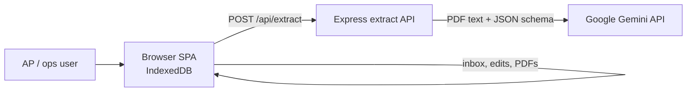
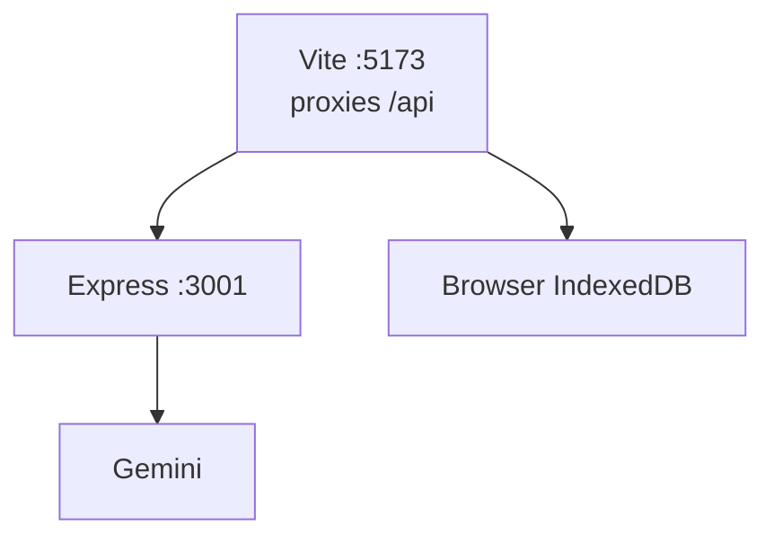
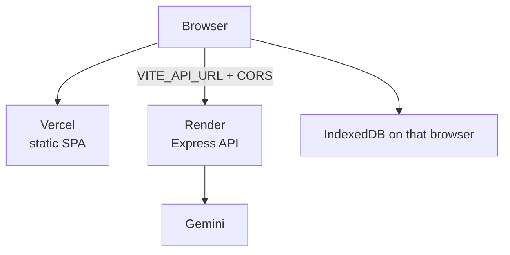
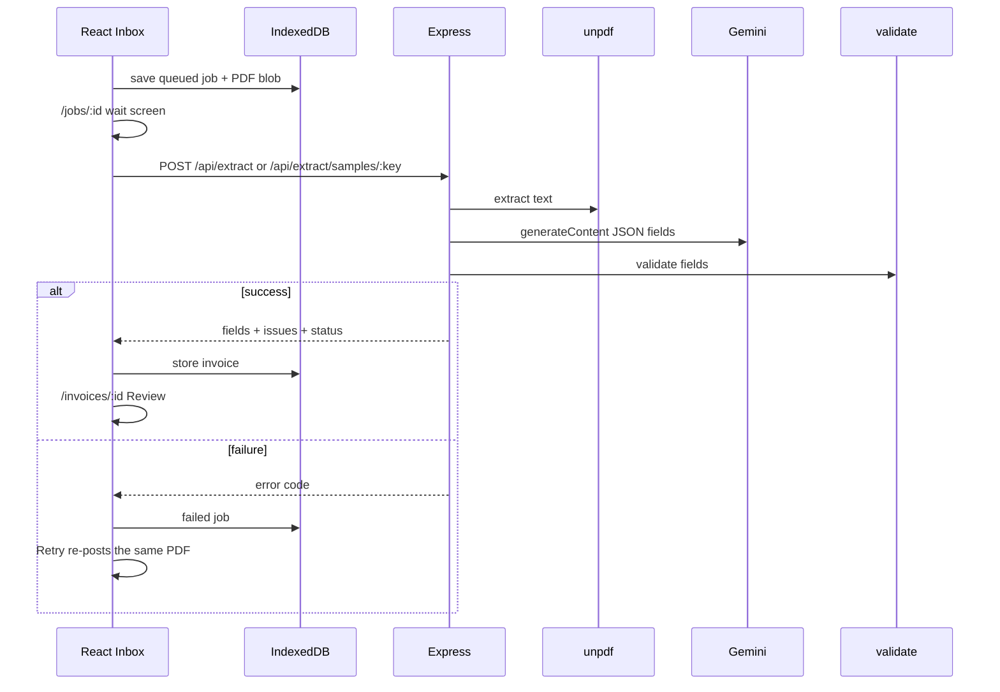

# Ledger Lens - architecture design

## 1. Purpose

Ledger Lens turns messy vendor invoice PDFs into structured, reviewable data.

The hard problem is not “call an LLM.” Extraction is often wrong. The product therefore:

1. Extracts with Gemini into a **fixed field schema**
2. Runs a **deterministic validator** (totals, date, currency, invoice #)
3. Shows confidence and issues on a **Review** screen
4. Treats the **user’s edit as source of truth**

Not in scope: auth, chat/RAG, OCR-as-main-path, search filters, multi-tenant, or a regex/template field parser.

---

## 2. System context

The API is stateless. Gemini never sees the PDF bytes - only extracted text (capped). Each browser keeps its own invoices; they are not shared.

---

## 3. Repository shape

npm workspaces monorepo:

| Path | Role |
| --- | --- |
| `frontend/` | Vite + React + TypeScript SPA |
| `backend/` | Express extract API |
| `sample-docs/` | Built-in demo PDFs |
| `.github/workflows/` | `ci.yml` (lint + tests) and Vercel deploy notify |
| `decisions.md` | Running product/stack decisions |
| `ERD.md` | Browser storage diagram |

---

## 4. Runtime architecture

### Local development

- `npm run dev` starts Vite + Express.
- Vite proxies `/api` and `/health` to the API so the browser stays same-origin.

### Production (Vercel + Render)

- UI: [https://ledger-lens-demo.vercel.app/](https://ledger-lens-demo.vercel.app/)
- API: [https://ledger-lens-api-ui6w.onrender.com/health](https://ledger-lens-api-ui6w.onrender.com/health)
- Vercel builds the SPA and copies it to repo-root `dist` (`vercel.json`).
- Render runs `npm start` (API only). Set `GEMINI_API_KEY` and `CORS_ORIGIN=https://ledger-lens-demo.vercel.app`.
- Frontend calls Render via `VITE_API_URL=https://ledger-lens-api-ui6w.onrender.com` (must be set at Vercel **build** time).

---

## 5. Request / extract pipeline

### Job states

`queued` → `extracting` → `needs_review` | `ready` | `failed`

Retry re-sends the PDF already stored in this browser.

### Extract details

1. **unpdf** - text only from digital PDFs (not OCR)
2. **Gemini** - fixed JSON shape (vendor, invoice #, date, currency, money fields, line items + confidence/snippets)
3. **Retries** - transient 503/429 with backoff; optional model fallback list
4. **Clip** - PDF text truncated (~8k chars) before the prompt
5. **Validator** - missing invoice #, bad date/currency, line-item sum vs total (`TOTAL_MISMATCH`)

User save on Review runs `applyUserEdits` in the browser and writes IndexedDB. Fields become `sourceOfTruth: user`.

---

## 6. API surface

| Method | Path | Purpose |
| --- | --- | --- |
| `GET` | `/health` | Liveness (Render health check) |
| `GET` | `/api/health` | Same payload for the UI health page |
| `GET` | `/api/health/gemini` | Validate the Gemini API key (model lookup, not a generate call) |
| `POST` | `/api/extract` | Upload PDF, return fields (multipart) |
| `POST` | `/api/extract/samples/:key` | Extract a built-in sample |
| `GET` | `/api/samples/:key` | Sample PDF bytes for Review preview |

Inbox, job retry, invoice load, and save are **local** (IndexedDB). No Postgres.

---

## 7. Data model

Two IndexedDB stores in this browser only. See [ERD.md](./ERD.md).

| Store | Responsibility |
| --- | --- |
| `records` | Job/invoice metadata, extracted fields, validator issues, edits |
| `files` | PDF blobs for preview and retry |

Clearing site data empties the inbox. Another device or browser starts empty.

---

## 8. Frontend architecture

| Route | Screen | Role |
| --- | --- | --- |
| `/` | Inbox | Samples, upload, infinite-scroll Recent list |
| `/health` | Health | Two checks: extract API up, and Gemini key/connection |
| `/jobs/:jobId` | JobWait | Progress while the extract POST runs; Retry on failure |
| `/invoices/:id` | Review | PDF preview + editable fields + Save changes |

Patterns:

- React Router SPA
- `api.ts` talks to Render for extract; IndexedDB for everything else
- Toasts for success/error
- Field/status chips for trust and review state
- TypeScript types mirror invoice/job shapes

---

## 9. Cross-cutting concerns

### Configuration

Backend env is documented in the README and `.env.example`. Only `GEMINI_API_KEY` is required; the rest have defaults if unset on Render.

| Variable | Required | Default | Use |
| --- | --- | --- | --- |
| `GEMINI_API_KEY` | yes | none | Server-only Gemini key |
| `CORS_ORIGIN` | recommended in prod | empty = allow any | Vercel origin |
| `PORT` | no | `3001` (Render injects) | Listen port |
| `GEMINI_MODEL` | no | `gemini-3.8-flash` | Primary model |
| `GEMINI_FALLBACK_MODELS` | no | `gemini-3.8-flash,gemini-flash-latest` | Fallback ids |
| `GEMINI_TIMEOUT_MS` | no | `25000` | Extract timeout |
| `GEMINI_PING_TIMEOUT_MS` | no | `15000` | Health ping timeout |
| `GEMINI_RETRIES` | no | `4` | 503 retries |
| `GEMINI_RETRY_MS` | no | `2500` | Retry delay |
| `GEMINI_MAX_CHARS` | no | `8000` | PDF text clip |
| `MAX_UPLOAD_MB` | no | `10` | Upload size cap |
| `VITE_API_URL` | yes on Vercel | empty (Vite proxy in local) | Frontend build-time API origin |

### Failure modes

| Case | Behavior |
| --- | --- |
| Non-PDF / oversize | `400` with human message |
| Unreadable / empty PDF text | Job `failed` (`UNREADABLE` / `EMPTY_TEXT`) |
| Gemini 503 / 429 | Retry, then `MODEL_OVERLOADED` / `RATE_LIMIT` + Retry UI |
| Bad JSON / timeout / missing key | Mapped error codes, user can retry |
| Totals mismatch | Invoice `needs_review` + banner; user fixes total |

### Security (demo posture)

- No auth
- API key never sent to the browser
- Digital PDFs only; no OCR pipeline
- Data is per-browser, not a shared workspace
- Set `CORS_ORIGIN` in production so other sites cannot burn your Gemini quota

### Quality gates

- Husky + lint-staged: ESLint on staged JS/TS
- CI: one workflow (`ci.yml`) with four jobs — Frontend lint, Frontend tests, Backend lint, Backend tests
- Vercel deploy notify (`vercel-deploy-notify.yml`): Discord and/or Telegram on success/fail; commit comment if those secrets are missing

---

## 10. Design tradeoffs (summary)

Documented in detail in [decisions.md](./decisions.md). Headline choices:

- **Gemini over OpenAI** - free-tier API usable for a demo
- **Vercel UI + Render API** - no Postgres; browser holds inbox/review state
- **AI + validator + human review** - not a layout-specific parser
- **TS frontend / JS backend** - type the product surface; ship Express faster
- **Synchronous extract POST** - no job table or poll loop on the server

---

## 11. Related docs

| Doc | Contents |
| --- | --- |
| [README.md](./README.md) | Setup, scripts, Vercel + Render deploy |
| [decisions.md](./decisions.md) | Why each major choice |
| [ERD.md](./ERD.md) | Browser storage diagram |
| [vercel.json](./vercel.json) | Vercel build / SPA rewrites |
| [render.yaml](./render.yaml) | Render web service |
| [vercel-deploy-notify.yml](./.github/workflows/vercel-deploy-notify.yml) | Discord / Telegram / commit comment on Vercel deploy |
