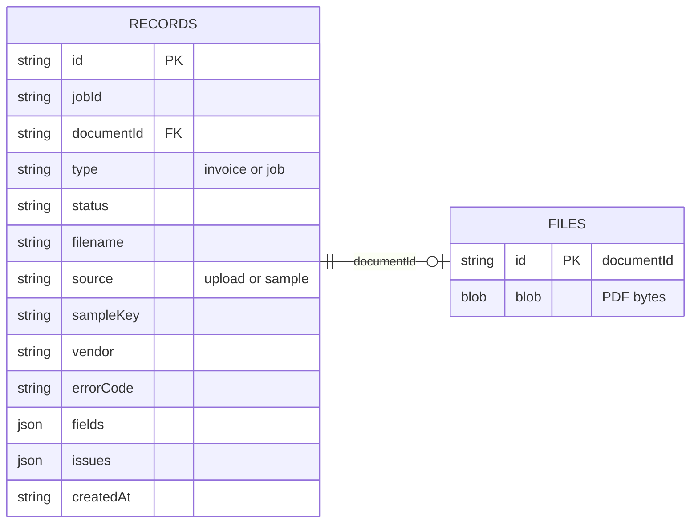

# Ledger Lens storage diagram

Invoices live in **this browser** (IndexedDB), not Postgres. Another user, device, or a cleared cache starts empty.

Flow: **file blob** + **queued record** → extract API → **invoice record** (or **failed job**). Retry re-sends the same blob. Save edits update `fields` / `issues` / `status` on that record.

Samples also keep a copy of the PDF in `files` so Review can preview without calling the API again.
